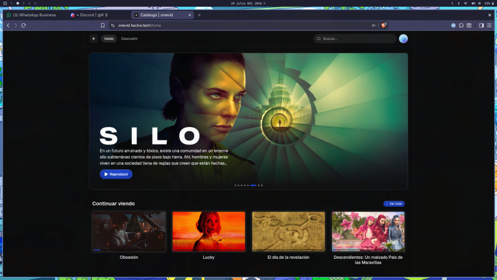

# onevid

[](https://deepwiki.com/j1zuz/onevid)

Reproductor de vídeo.



- **Web:** [onevid.hackw.tech](https://onevid.hackw.tech)
- **Android:** [Google Play](https://play.google.com/store/apps/details?id=tech.hackw.onevid)

## Desarrollo

```bash
bun install
bun dev
```

## Deploy

El deploy lo hace **Cloudflare Workers Builds** al hacer push a `main`
(trigger del repo `j1zuz/onevid`, root `apps/web`). No hay deploy local:
`main` es la única rama que despliega.

Para probar el build en local, sin publicar:

```bash
cd apps/web
bun run build:vinext    # compila el Worker
bun run start:vinext    # sirve ese build en local
```

Para desarrollo con hot reload y bindings locales:

```bash
bun run dev:vinext
```

Este repo no tiene un script de deploy local a propósito: publicar desde local
salta el CI y puede hornear variables de entorno equivocadas.
