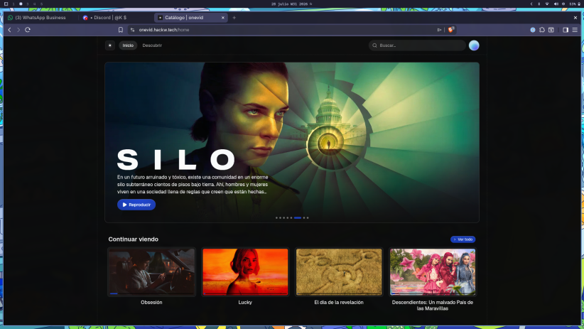

# onevid

[](https://deepwiki.com/j1zuz/onevid)

Reproductor de vídeo.



- **Web:** [onevid.hackw.tech](https://onevid.hackw.tech)
- **Android:** [Google Play](https://play.google.com/store/apps/details?id=tech.hackw.onevid)

## Desarrollo

```bash
bun install
# una vez: columnas de proveedores debrid (TorBox + Real-Debrid), rate limit
# distribuido y lockout de PIN
bun --filter web db:debrid
bun --filter web db:rate-limit
bun --filter web db:profile-lockout
bun dev
```

Para `cf`/vinext en local con Hyperdrive, define `CF_HYPERDRIVE_DEV_URL` en
`apps/web/.env.local` (no uses `DATABASE_URL` para el binding: se serializa en
el artefacto de build). Ver [`docs/security-hardening.md`](./docs/security-hardening.md),
[`docs/debrid.md`](./docs/debrid.md) y [`docs/offline.md`](./docs/offline.md).

## Deploy

El deploy lo hace **Cloudflare Workers Builds** al hacer push a `main`
(trigger del repo `j1zuz/onevid`, root `apps/web`). No hay deploy local:
`main` es la única rama que despliega.

Para probar el build en local, sin publicar:

```bash
cd apps/web
bun run build:vinext    # compila el Worker
bun run start:vinext    # sirve ese build en local
```

Para desarrollo con hot reload y bindings locales:

```bash
bun run dev:vinext
```
